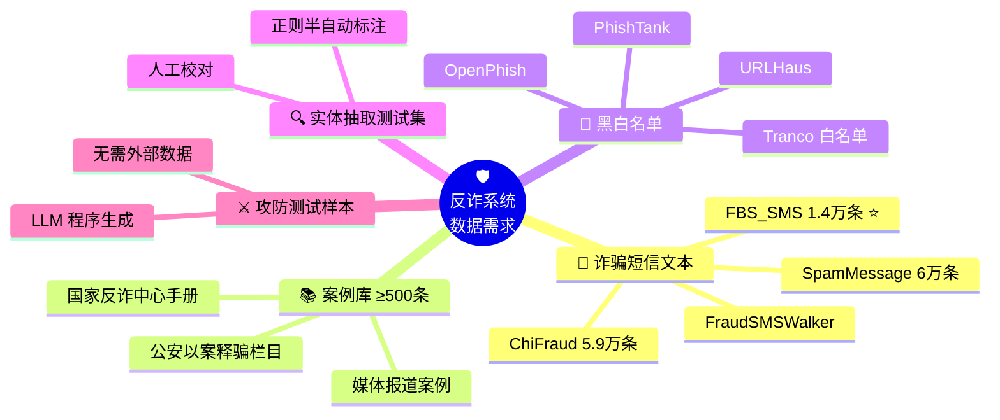
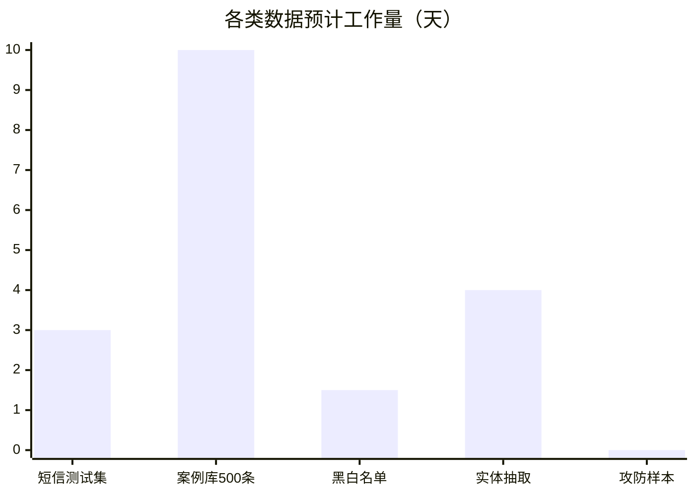

# 🛡️ 反诈信息核验系统 · 数据源清单

> [!abstract]+ 📋 文档说明
> 依据 [[毕业设计/需求规格说明书]] 整理，按系统实际数据需求分为 **5 大类**。
> **总体结论：数据收集不难，核心数据源均有现成开源数据集，不构成本项目瓶颈。**

---

## 🗺️ 数据源全景图

---

## 1️⃣ 诈骗 / 垃圾短信文本数据集

> [!success]+ 现成度 ⭐⭐⭐⭐⭐ —— 直接下载即用

### 🥇 首选：FBS_SMS_Dataset

   

国内真实伪基站发送的诈骗/垃圾短信，联系人信息已匿名化。出自清华团队顶会论文《Lies in the Air》，**中文诈骗短信领域最权威的开源数据集**。

🔗 `github.com/Cypher-Z/FBS_SMS_Dataset`

### 📦 其他可用数据集

| 数据集 | 规模 | 特点 | 链接 |
|:---|:---|:---|:---|
| **SpamMessage** | ~6 万条 | 中文垃圾/恶意广告短信，作负样本补充 | [GitHub](https://github.com/hrwhisper/SpamMessage) |
| **ChiFraud** `COLING 2025` | 59,106 条 | 中文欺诈网页文本，10 个诈骗类别，适合扩充骗局类型覆盖 | [GitHub](https://github.com/xuemingxxx/ChiFraud) |
| **SpamMessageDataset-CN** | 较小 | 个人手工收集，UTF-8 编码 | [GitHub](https://github.com/M-Quadra/SpamMessageDataset-CN) |
| **FraudSMSWalker** `2026` | 699 条链路（含 381 中文） | 短信→落地页全链路欺诈检测基准 | [arXiv](https://arxiv.org/html/2606.16659v1) |
| **CLUEDatasetSearch** | 索引平台 | 中文 NLP 数据集搜索引擎 | [GitHub](https://github.com/CLUEbenchmark/CLUEDatasetSearch) |

> [!warning]+ ⚠️ 注意
> 正常短信（ham）样本相对少 → 用 FBS 分类标签 + 自行收集的正常短信平衡正负样本。

---

## 2️⃣ 案例库素材来源

> [!tip]+ 现成度 ⭐⭐⭐ —— 素材充足，需人工整理（1–2 周）
> 无现成结构化数据集，需从公开渠道整理 **≥500 条**（对应说明书 §2.5）。

| 来源 | 说明 | 链接 |
|:---|:---|:---|
| 📕 **国家反诈中心宣传手册 2025 版** | 官方按骗局类型整理案例 + 防范建议，结构完美匹配知识库需求 | [PDF](https://www.hsbc.com.cn/content/dam/hsbc/cn/docs/customer-education/anti-telecom-fraud-brochure-2025.pdf) |
| 👮 **公安"以案释骗"栏目** | 各地公安网站发布的诈骗类型解析与案例 | [示例](https://gaj.shaoyang.gov.cn/sygaj/jfts/202102/14d542f2e7aa4029aa4252f57015328a.shtml) |
| 📰 **媒体报道案例** | 澎湃、搜狐等真实案例报道，可爬取 | [示例](https://m.thepaper.cn/baijiahao_15101938) |
| 🗄️ **ChiFraud 数据集** | 5.9 万条已分类欺诈文本，可作案例库主体 | 见第 1️⃣ 节 |

---

## 3️⃣ 黑白名单数据源

> [!success]+ 现成度 ⭐⭐⭐⭐⭐ —— 免费下载 / 免费 feed

### 🎣 黑名单：钓鱼 URL / 恶意域名

| 来源 | 类型 | 说明 | 链接 |
|:---|:---|:---|:---|
| **PhishTank** | 社区数据库 | OpenDNS 旗下，人工验证，支持批量下载 | [官网](https://phishtank.com) |
| **OpenPhish** | 实时 Feed | 免费钓鱼 URL 文本流 | [feed.txt](https://openphish.com/feed.txt) |
| **URLHaus** | 威胁跟踪 | abuse.ch 恶意 URL / 域名 / IP | [官网](https://urlhaus.abuse.ch) |
| **Kaggle Malicious URLs** | 静态数据集 | 65 万条（良性/钓鱼/篡改/恶意软件） | [Kaggle](https://www.kaggle.com/datasets/sid321axn/malicious-urls-dataset) |
| **UCI PhiUSIIL** | 学术数据集 | 23.5 万条 URL + 56 维特征 | UCI ML Repo |
| **awesome-threat-intelligence** | 资源合集 | 威胁情报源大全（含中文 README） | [GitHub](https://github.com/hslatman/awesome-threat-intelligence) |
| **mengguiyouziyi/phish** | 构建脚本 | 内置从多源构建数据集的 `build_dataset.py` | [GitHub](https://github.com/mengguiyouziyi/phish) |

### ✅ 白名单：良性网站

- **Tranco Top 1M** —— 主流研究用良性域名排行，直接下载
- **Alexa Top 1M**（历史存档）—— 经典良性站点列表

### 📞 电话号码黑名单

> [!note]+ 无权威开源库（涉及隐私）
> 毕设中可用 **FBS 数据集中的发信号码 + 自行构造测试号码**。验收仅要求三类条目可增删改查且命中影响判定（§3.2.4），无需真实规模数据。

---

## 4️⃣ 实体抽取测试集

> [!example]+ 现成度 ⭐⭐⭐⭐ —— 半自动标注（3–5 天）
> 电话、银行卡、网址、金额、App 名称五类实体格式规则性强：
> **从 FBS / SpamMessage 数据中正则半自动标注 + 人工校对**，数百条即可满足 E2 实验（准确率 ≥90%）。

---

## 5️⃣ 攻防测试样本

> [!example]+ 现成度 ⭐⭐⭐⭐⭐ —— 程序生成，零收集成本
> 按说明书 §3.6 设计，由 LLM 从诈骗短信派生：
> - 🔤 **字符级**：谐音、拆字、emoji 插入
> - 📝 **语义级**：改写、方言化
> - 🧩 **拼接级**：多轮拆分
> - 💉 **注入样本**：提示词注入指令

---

## 📊 获取难度总评

| 数据类别 | 现成度 | 预计工作量 |
|:---|:---:|:---|
| 📱 诈骗短信测试集 | ⭐⭐⭐⭐⭐ | 几天（清洗 + 标注划分） |
| 📚 案例库 500 条 | ⭐⭐⭐ | 1–2 周 ⚠️ |
| 🚫 黑白名单 | ⭐⭐⭐⭐⭐ | 1–2 天 |
| 🔍 实体抽取测试集 | ⭐⭐⭐⭐ | 3–5 天 |
| ⚔️ 攻防样本 | ⭐⭐⭐⭐⭐ | 含在开发内 |

> [!important]+ 🎯 结论
> 数据不是本项目瓶颈。**最需要提前启动的是案例库 500 条的结构化整理**（唯一无现成数据集的部分），建议与开发并行推进；其余数据基本"拿来即用"。
